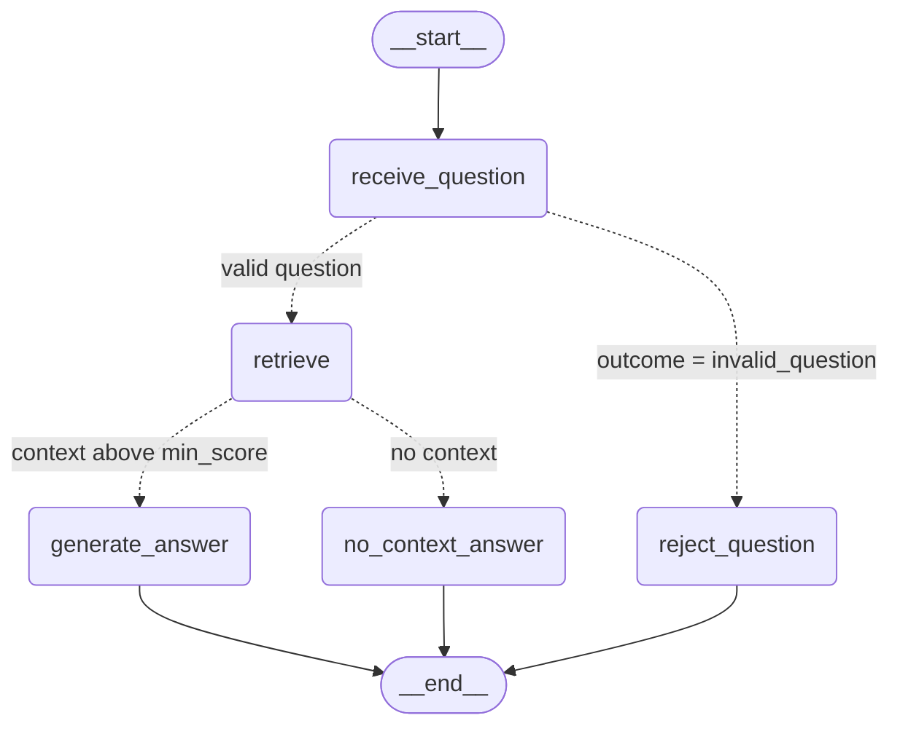
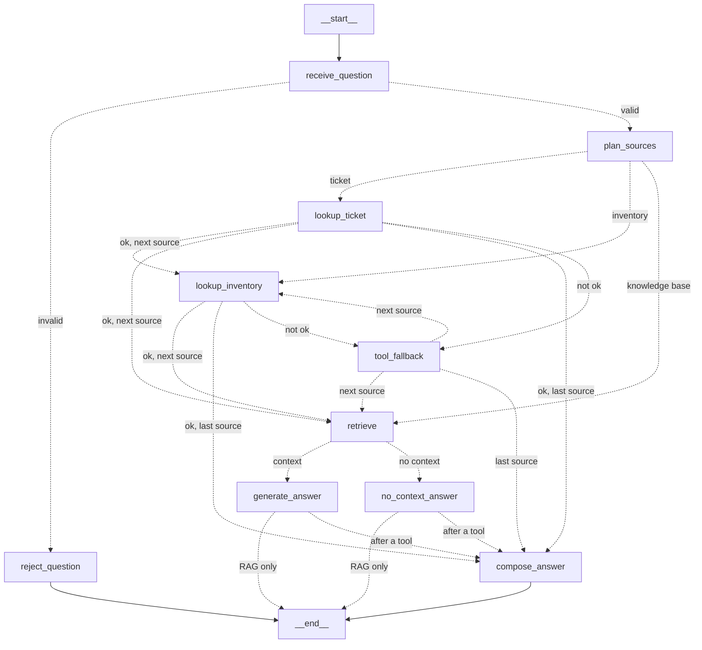

# Coordinator knowledge agent — LangGraph (Part 1 of 2)

The coordinator knowledge assistant from Milestone 7 (PLAN-102) now runs as a compiled LangGraph graph. It gives the same answers from the same four policy documents. The difference is that every decision is now a node or an edge, and every run leaves a trace you can query.

- Package: [`services/knowledge_agent/`](../../services/knowledge_agent/)
- Endpoint: `POST /agent/query` (JWT). It sits next to the unchanged `POST /knowledge/query`.
- Reused, not rewritten: `retrieve()`, `generate_answer()`, `NO_CONTEXT_SENTENCE`, and `KnowledgeBaseUnavailable` from [`data/pipelines/rag.py`](../../data/pipelines/rag.py); `setup()` and `embed()` from [`data/process/rag.py`](../../data/process/rag.py). The agent never calls `query()`.

## Graph



Dotted lines are conditional edges. LangGraph draws the same picture from the compiled graph with `runner.graph.get_graph().draw_mermaid()`, and the recorder stores it in the trace export.

| Node | Single responsibility | Calls |
|------|----------------------|-------|
| `receive_question` | Collapse whitespace. Mark `invalid_question` when the question is empty or over 1000 characters. | — |
| `retrieve` | Fetch chunks at or above `min_score` (0.30). Log chunk ids and scores only. | `rag.retrieve(question)` |
| `generate_answer` | Generate from the context `retrieve` already produced. | `rag.generate_answer(question, context)` |
| `no_context_answer` | Give the honest "not enough information" reply, with no model call. | `rag.NO_CONTEXT_SENTENCE` |
| `reject_question` | Ask the coordinator to type a question. | — |

Behaviour change from `query()`: when nothing scores above the threshold, the old path still sent an empty context to the model. The graph now routes to `no_context_answer` instead, so the model is never asked to answer from nothing.

## State

`AgentState` has four keys: `question`, `context`, `answer`, and `outcome`. There is no conversation history. Coordinator desk questions are single-turn, and no node reads an earlier turn. Each run gets its own checkpointer thread (`thread_id = run_id`), and that thread is how a run is inspected or resumed.

## Compile-time safety

`compile_agent_graph()` is the only way to get a runnable graph. `AgentRunner` calls it in its constructor, and the API builds the runner in the FastAPI lifespan, so a broken graph stops startup. It raises `AgentGraphBuildError` for:

- An edge to an unknown node. LangGraph itself rejects this, and the error is wrapped with a clear message.
- A node not reachable from `START`, or with no path to `END`. LangGraph 1.2 would accept both silently.
- A node declaring a state key that is not in `AgentState`, such as a typo like `answr`. LangGraph would silently drop the write.

At run time, each node is wrapped. A node that returns a key it did not declare fails with `AgentStateError`, and the trace records that node as failed.

## Checkpointing and resume

`SqliteSaver` writes one checkpoint per super-step: input, `receive_question`, `retrieve`, and the terminal node. The file is `services/knowledge_agent/.state/checkpoints.sqlite` (gitignored; override with `AGENT_STATE_DIR`).

```python
runner.checkpoints(run_id)   # [{step: -1, next: ['__start__']}, ... {step: 3, next: []}]
runner.resume(run_id)        # continue a failed run; finished nodes do not re-run
```

When `generate_answer` fails (for example, the model gateway is down), `resume()` continues from the checkpoint after `retrieve`, so retrieval does not run twice. `tests/pipelines/test_agent_graph.py` checks this.

## Trace

Every run writes to `services/knowledge_agent/.state/traces.sqlite`:

- `agent_runs`: one row per run, with status, outcome, failed node, error type, and a question hash and length.
- `agent_steps`: one row per node update, in order, with duration and output. The output for `retrieve` holds the hits (document, chunk, section, score). The output for answer nodes holds the answer length and Source line.

The API never stores question or answer text in the trace unless `AGENT_TRACE_STORE_TEXT=true`. Eval recordings of synthetic questions set that flag. Optional LangSmith export works without code changes through LangGraph's `LANGSMITH_*` env vars.

```sql
-- node path of the latest runs
SELECT r.run_id, r.outcome, group_concat(s.node, ' -> ') AS path
FROM agent_runs r JOIN agent_steps s USING (run_id)
GROUP BY r.run_id ORDER BY r.started_at DESC LIMIT 20;

-- failures by node
SELECT failed_node, error_type, count(*) FROM agent_runs WHERE status = 'failed' GROUP BY 1, 2;
```

```python
from services.knowledge_agent import TraceStore
store = TraceStore("services/knowledge_agent/.state/traces.sqlite")
store.get_run(run_id); store.node_sequence(run_id); store.list_runs(outcome="no_context")
```

The API 500 and 503 responses include `Reference: <run_id>`, so support can find the trace without the API exposing internals.

## Evals

| File | What |
|------|------|
| [`tests/pipelines/agent_eval_cases.json`](../../tests/pipelines/agent_eval_cases.json) | 8 cases: 6 grounding cases (cancellation fee, Medicare no-show, US insurers, new-patient documents, referral escalation, Humana unlisted) and 2 routing cases (off-topic, blank). |
| [`scripts/record_agent_traces.py`](../../scripts/record_agent_traces.py) | Runs each case once through the compiled graph and writes [`tests/pipelines/fixtures/agent_traces.json`](../../tests/pipelines/fixtures/agent_traces.json). |
| [`tests/pipelines/test_agent_evals.py`](../../tests/pipelines/test_agent_evals.py) | Asserts on the recorded trace only: the node path, the outcome, the top retrieved document, the BRIEFING facts in the answer, the Source line, `retrieve` running once and before generation, and no generation on empty context. |
| [`tests/pipelines/test_agent_graph.py`](../../tests/pipelines/test_agent_graph.py) | Mechanics with stubs: compile errors, routing, checkpoints, resume, and trace privacy and persistence. |
| [`docs/agent/eval-output.txt`](./eval-output.txt) | Console output of the last eval run. |

```bash
uv run python scripts/record_agent_traces.py --mode live      # needs the 4Geeks key + indexed Qdrant
uv run python scripts/record_agent_traces.py --mode offline   # no key: real corpus/setup/retrieve/generate_answer,
                                                              # in-memory Qdrant, lexical embedding, extractive stand-in LLM
uv run pytest tests/pipelines/test_agent_evals.py -v          # the evals (single command)
uv run pytest tests/pipelines/test_agent_evals.py tests/pipelines/test_agent_graph.py tests/pipelines/test_rag.py
                                                               # evals + mechanics + existing RAG tests
python -m pytest tests/pipelines                               # whole folder; test_pipeline.py needs the API
                                                               # requirements (sqlalchemy, prefect), not in pyproject
python -m pytest                                               # API suite (from repo root)
```

Every trace export records its `mode`. The offline trace proves the wiring, the routing, and that grounded chunks reach the answer. It cannot prove that the real model stays faithful. Re-record with `--mode live` before opening the PR. The live-only Humana case (never confirm an unlisted insurer) is skipped against an offline trace and runs against a live one.

## Part 2 — External tools (ticket and inventory)

Plan: [PLAN-108](../../memory-bank/plans/HC-MS7-PLAN-108-20261104-langgraph-external-tools-plan.md). The agent can now read two live HealthCore systems as well as the knowledge base. It decides per question whether to use the knowledge base, a tool, or both.

| Tool | Reads | Responsibility |
|------|-------|----------------|
| `ticket_lookup` (`tools/incidents.py`) | `GET /api/incidents/{id}` or `GET /api/incidents?status=&category=&clinic_id=` on the incident manager | Look up one ticket by id, or count tickets by filter |
| `inventory_lookup` (`tools/inventory.py`, stretch) | `GET /inventory/products` | Report stock and reorder threshold for a named product |

The incident manager had no read endpoints, so Part 2 adds them to our own service. `POST /api/incidents/analyze` now upserts the valid rows of each uploaded CSV into `services/api/data/incidents.json` (gitignored), and `seed.py` loads the sample CSV. The read endpoints never return `patient_id`.

### Contracts, auth, read-only, timeout

- Input and output are Pydantic models in `tools/contracts.py`. `ticket_id` must match `^INC-\d{4,6}$`, and unknown fields are rejected. Every output carries a `status` from `ok`, `not_found`, `invalid_input`, `timeout`, `unavailable`, `auth_failed`, or `bad_response`, plus `endpoint`, `http_status`, and `latency_ms`.
- Both API services require a JWT. The agent signs in as a service account through `POST /auth/login` and refreshes the token once on a 401. Credentials come only from env vars, and no token is hardcoded:

  | Env var | Default |
  |---------|---------|
  | `HEALTHCORE_API_URL` | `http://localhost:8001` |
  | `AGENT_SERVICE_EMAIL`, `AGENT_SERVICE_PASSWORD` | none. If they are missing, the tool returns `auth_failed` and the graph falls back. |

- `ReadOnlyApiSession` (`tools/session.py`) allows only `GET` (plus the login `POST`). Any other method raises `ReadOnlyViolation` before a request is sent.
- `TOOL_TIMEOUT_SECONDS = 4.0` is a deadline for the whole tool call, including login. A real server that never replies times out in about 4.0 s; the live AG16 trace shows 4009 ms.

### Routing

`plan_sources` asks the LLM for a JSON plan (`sources`, `ticket_input`, `inventory_input`, `knowledge_question`), with an 8 s timeout and one retry. If the reply is invalid or slow, the rules planner (`planner.rules_plan`) takes over, and the trace records `planner: rules_fallback`. A ticket id counts only if it appears in the question text, so the model cannot invent one. For a mixed question, the knowledge base gets only the policy part (`knowledge_question`). Offline recordings use the rules planner.



- `tool_fallback` turns a failed tool call into an honest reply. For example: "I couldn't confirm ticket INC-0042's status right now: the incident manager did not respond in time. Please try again in a moment, or check it directly in the HealthCore backoffice." It never states a status. The outcome is `tool_fallback`, and the API still returns 200.
- `compose_answer` writes tool facts word for word from the tool output ("Ticket INC-0042 is closed. … Source: HealthCore incident manager (live)"). In a mixed answer, it adds the knowledge-base answer under "From the HealthCore knowledge base:". The LLM never words a status or a stock figure.
- Pure knowledge-base questions keep the Part 1 path, with `plan_sources` added before `retrieve`.

### Trace

Tool steps log `tool`, `status`, `method` (always `GET`), `endpoint`, `http_status`, `latency_ms`, and the returned ids, statuses, or SKUs and stock levels. They never log tokens or URLs. `plan_sources` logs `sources`, `planner`, and the ticket input. `agent_runs` gets `sources_used`, and `POST /agent/query` returns `sources`.

```python
store.source_sequence(run_id)   # e.g. ['incident_manager', 'knowledge_base']
```

```sql
-- which source each run used, in order, with tool status and latency
SELECT run_id, node, json_extract(output, '$.tool_call.status') AS status,
       json_extract(output, '$.tool_call.latency_ms') AS ms
FROM agent_steps WHERE node IN ('plan_sources', 'lookup_ticket', 'lookup_inventory', 'retrieve')
ORDER BY run_id, seq;
```

### Evals (AG09–AG19)

Cases are in `tests/pipelines/agent_eval_cases.json`:

- Tool, not knowledge base: AG09–AG11 (ticket by id, short number, filtered count).
- Knowledge base, not tool: AG12, plus AG01–AG07, which must not call any tool.
- Both: AG13.
- Fallback: AG14 (not found), AG15 (unreachable), AG16 (timeout), and AG19 (auth failure).
- Inventory: AG17 (stock) and AG18 (unknown product).

The recorder runs the real tools against the running API. For AG15 and AG16 it points them at a closed port and at a socket that never replies, so those cases exercise a real outage and a real timeout. Recording needs the API on `HEALTHCORE_API_URL` and the service-account env vars:

```bash
uv run python scripts/record_agent_traces.py --mode live
uv run pytest tests/pipelines/test_agent_evals.py -v
uv run pytest tests/pipelines/test_agent_tools.py tests/pipelines/test_agent_graph.py   # tool and graph mechanics
```

## Known limits

- Checkpoints hold full state, including the question, because resume needs it. They stay in the local gitignored `.state/` folder.
- There is no retention job for `.state/` yet.
