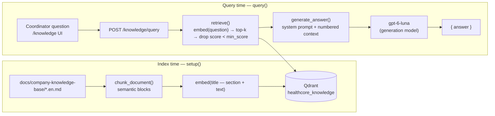

# HealthCore Coordinator Knowledge Base — RAG Design

**Milestone 7 · RAG & Knowledge Base** · Briefing: [`healthcore-rag-BRIEFING.en.md`](../Project_Contexts/healthcore-rag-BRIEFING.en.md) · Plan: `HC-MS7-PLAN-101`

## Who it is for

Priya Nair (Head of Patient Experience) has eight patient coordinators who answer the same questions at the front desk and on the phone: which insurance we accept, how cancellations work, how long a referral takes, and what a new patient must bring. The assistant answers those questions **for the coordinator**, in the voice of the clinic's best service salesperson: clear, empathetic, and never inventing coverage or policy.

The knowledge base contains policy and procedure text only. It contains no patient data, and the API never logs the question text.

## Stack at a glance

| Piece | Choice |
|-------|--------|
| Corpus | `docs/company-knowledge-base/` — the four briefing documents, copied verbatim (English) |
| Vector DB | Qdrant, collection **`healthcore_knowledge`**, cosine distance |
| Embeddings model | `downtown-miami/openrouter/perplexity/pplx-embed-v1-0.6b` (1024 dimensions), 4Geeks OpenAI-compatible gateway |
| Generation model | `downtown-miami/openrouter/openai/gpt-6-luna`, same gateway, `temperature=0` |
| Orchestration | None — plain Qdrant SDK + OpenAI SDK + FastAPI |
| Endpoint | `POST /knowledge/query` `{question}` → `{answer}` (JWT required) |
| UI | Backoffice `/knowledge` ("Knowledge assistant") |

## Code map

| Responsibility | Function | File |
|----------------|----------|------|
| Read and chunk the corpus | `load_documents`, `chunk_document`, `build_chunks` | `data/process/rag.py` |
| Text → vector | `embed(text) -> list[float]` | `data/process/rag.py` |
| (Re)create the collection and upsert | `setup()` | `data/process/rag.py` |
| Vector search + threshold | `retrieve(query, *, k=5, min_score)` | `data/pipelines/rag.py` |
| Prompt assembly + LLM call | `build_prompt`, `generate_answer(question, context)` | `data/pipelines/rag.py` |
| Public entrypoint | `query(question) -> str` = `retrieve()` + `generate_answer()` | `data/pipelines/rag.py` |
| HTTP | `post_knowledge_query` (calls `query()` only) | `services/api/app/routers/knowledge.py` |
| UI | `KnowledgeAssistantPage` | `uis/backoffice/app/(internal)/knowledge/page.tsx` |
| Unit tests | mocked Qdrant / embed / LLM | `tests/pipelines/test_rag.py`, `services/api/tests/test_knowledge.py` |
| Retrieval eval | Recall@3 | `data/eval/test-queries.json`, `scripts/eval_rag_recall.py` → `data/eval/rag_recall_report.md` |

A later LangGraph agent can call `retrieve()` and `generate_answer()` as separate nodes without running retrieval twice.

## RAG process



1. **`setup()`** reads every `healthcore-*.en.md` in `docs/company-knowledge-base/`, splits each into semantic chunks, embeds each chunk, drops and recreates `healthcore_knowledge`, and upserts one point per chunk.
2. **Payload** per point: `company="healthcore"`, `source_document` (`insurance-coverage` | `appointment-policy` | `referral-process` | `new-patient-checklist`), `section`, `language="en"`, `chunk_index`, `text`.
3. **`retrieve()`** embeds the question with the same `embed()`, asks Qdrant for the top `k` (default 5) by cosine similarity, removes every hit below `min_score`, and returns plain payload dicts plus `score`. It can return fewer than `k`, or none.
4. **`generate_answer()`** builds the prompt: a coordinator-facing system prompt with the briefing rules, then the surviving chunks numbered as `[n] source_document › section`, then the question. It calls the generation model and returns its text.
5. **No context**: if nothing clears `min_score`, `generate_answer()` still calls the model, with an explicit "no relevant passages" context. The prompt forces the reply *"I don't have enough information in the HealthCore knowledge base to answer that."* The code never builds an answer from chunk text itself.
6. **Endpoint** returns `{ "answer": "..." }` only. Chunk ids and scores are logged server-side for debugging; chunk text, scores, and the question are never returned to the client, and the question is never logged.

### Prompt rules (from the briefing)

- Audience is the coordinator; voice is the best service salesperson: lead with the answer, then the conditions, short enough to read aloud.
- Use only the context; copy amounts, currencies, hours, and day counts exactly (Faithfulness KPI).
- Insurance questions without a country are answered separately for the United States and the United Kingdom.
- An insurer not in the context is never confirmed; the coordinator is told to verify with billing (Tom Callahan).
- No-show and late-cancellation fees never apply to Medicare or Medicaid patients, as `healthcore-appointment-policy.en.md` states.
- Never ask for or repeat patient identifiers.
- End with a `Source: document › section` line so every answer can be traced to its source.

## Chunking strategy

**One-line summary:** split on the document's own semantic blocks (a heading with its list, a labelled rule, or a standalone rule paragraph), never on a character count.

### Why

These are short policy documents (about 1 KB each). Almost every sentence is a rule with a condition: "*more than 24 hours* → no charge", "*Medicaid* → *Texas and Florida only*", "*5 business days* → escalate to Marcus Reid". A fixed-size splitter would separate a rule from its condition. Chunking on the author's own blocks keeps each rule and its conditions in one chunk.

### Rules (`chunk_document`)

1. The `# ` heading becomes the document **title**. It is not a chunk.
2. Text is split on blank lines into blocks. Soft line wraps are joined first. A new line starts only at a list marker (`- `, `* `, `1. `), so **no bullet, numbered step, or wrapped sentence is ever split**. A unit test checks this on the real corpus.
3. A block whose first line ends with `:` and is followed by list items (for example `Cancellation policy:` and its three bullets) is **one chunk**, and that line is its `section`.
4. A one-line lead-in that ends with `:` (for example "HealthCore accepts different coverage types depending on the country:") is **merged into the next block**, so the list keeps its framing.
5. A paragraph that starts `Label: sentence` (for example "Automated reminders: …", "Target completed-referral time: …") is its own chunk, and the label is its `section`.
6. Any other paragraph (a standalone rule such as the 3-no-shows flag or the billing-verification rule) is its own chunk, with `section` = document title.

### Result

| `source_document` | Chunks | Sections |
|-------------------|--------|----------|
| `appointment-policy` | 4 | Booking appointments · Cancellation policy · Automated reminders · 3-no-shows review rule |
| `insurance-coverage` | 3 | United States (Texas, Florida, Georgia) · United Kingdom (London and Manchester) · unlisted-insurer billing check |
| `new-patient-checklist` | 3 | Pre-visit checklist (4 steps) · Documents to bring · Missing medical-history form |
| `referral-process` | 4 | Standard 4-step process · Target completed-referral time · 5-business-day escalation · Out-of-network referrals |
| **Total** | **14** | 130–550 characters each (about 30–130 tokens) |

Every document produces at least 3 chunks, as the briefing requires. US and UK insurance are separate chunks, so a country-specific question retrieves the right list. For a question with no country, both chunks rank high and the prompt requires a US/UK split.

### Idempotency

`setup()` uses **clear-and-reload**: it deletes `healthcore_knowledge` if it exists, recreates it, and upserts every chunk. Point ids are also deterministic, `uuid5(namespace, "{source_document}:{chunk_index}")`, so an interrupted run that is resumed overwrites points instead of duplicating them. A unit test runs `setup()` twice against in-memory Qdrant and checks that the point count is unchanged.

## Embedding practices

| Item | Value |
|------|-------|
| Embeddings model | `downtown-miami/openrouter/perplexity/pplx-embed-v1-0.6b` (`RAG_EMBEDDING_MODEL`) |
| Generation model | `downtown-miami/openrouter/openai/gpt-6-luna` (`RAG_GENERATION_MODEL`) |
| Provider | 4Geeks student gateway (`llm.4geeks.ai`, OpenAI-compatible), `OPENAI_API_KEY` + `OPENAI_BASE_URL` in the local, gitignored `.env` |
| Vector dimension | 1024 (the collection is created with the length of the vectors actually returned) |
| Distance | Cosine |
| Same function both sides | `embed()` is used for chunks in `setup()` and for the question in `retrieve()` |

- **4Geeks-provided models.** Both models come from the 4Geeks student gateway; no personal paid key is used.
- **Two models, two jobs.** `embed()` only calls `embeddings.create` with the embeddings model. `generate_answer()` only calls `chat.completions.create` with the generation model. `assert_distinct_models()` raises an error if both env vars name the same model, and a unit test covers this.
- **Preprocessing.** `embed()` collapses whitespace and rejects empty text. Nothing else is changed; casing and punctuation are kept.
- **Index-time context header.** `setup()` embeds `"{document title} — {section}\n{text}"`. A chunk such as "No coordinator should confirm coverage for an insurer not listed here…" does not name its topic, so the header supplies "Accepted Insurance Coverage". The stored `text` payload is the body only, which keeps the prompt clean. Questions are embedded as typed.
- **Normalization.** Qdrant normalizes vectors in cosine collections, so scores are comparable across documents whatever the model's raw vector length.
- **Why these model ids.** The 4Geeks student gateway only serves an allowlist per team. `text-embedding-3-small` and `gpt-4o-mini` return 403 for this team. `pplx-embed-v1-0.6b` is the only embeddings model on the list. `gpt-6-luna` was chosen over `deepseek-v4-flash` for instruction-following on the strict prompt rules (`glm-5.3-flash` is listed but not callable). Both ids are env-configurable.

### `min_score` threshold

**`min_score = 0.30`** (cosine, env `RAG_MIN_SCORE`), tuned on `data/eval/test-queries.json` with the live models:

| Measurement (k=3) | Score |
|-------------------|-------|
| Lowest score of the correct chunk across the 16 in-domain questions | **0.504** |
| Highest top-1 score across the 4 off-topic questions (capital city, restaurant, Wi-Fi password, printer) | **0.105** |

0.30 sits roughly midway in that gap, about 0.2 from each side. A higher value such as 0.45 would still keep every correct chunk, but it would drop useful secondary context. For example, the UK coverage chunk scores 0.26–0.37 on US-leaning insurance questions, and the prompt needs both countries when the question gives none. A lower value such as 0.15 would sit too close to the off-topic ceiling. With 0.30, Recall@3 stays at **100%** and every off-topic question returns zero chunks, so the model gives the "not enough information" reply. To re-tune after changing the corpus or the embeddings model, run `scripts/eval_rag_recall.py` with `--min-score 0` and read the two numbers above.

### Results

Full report: [`data/eval/rag_recall_report.md`](../../data/eval/rag_recall_report.md). Recall@3 is **100%** (16/16, every correct chunk ranked first), and the target is 80% or higher.

## Running it

```bash
# Qdrant (or leave QDRANT_URL unset to use embedded local storage at data/process/.qdrant/)
docker compose up -d qdrant
# local .env (never committed): OPENAI_API_KEY, OPENAI_BASE_URL, optional QDRANT_URL=http://localhost:6333

uv run python -m data.process.rag                         # setup(): index the corpus, print chunk counts
uv run python scripts/eval_rag_recall.py --answers        # Recall@3 + sample answers → data/eval/rag_recall_report.md
uv run python -m pytest tests/pipelines/test_rag.py       # unit tests, no live services

# API + UI
cd services/api && python -m uvicorn app.main:app --reload --port 8001
cd uis/backoffice && npm run dev                          # http://localhost:3001/knowledge
```

Note: embedded local Qdrant allows only one process at a time. Use the Compose `qdrant` service when the API and scripts run together.
